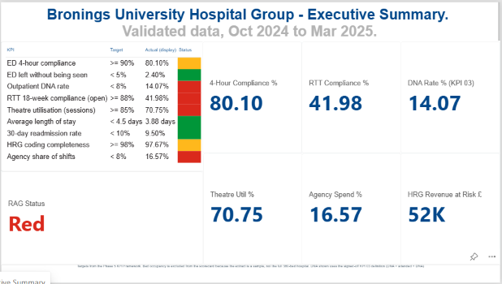
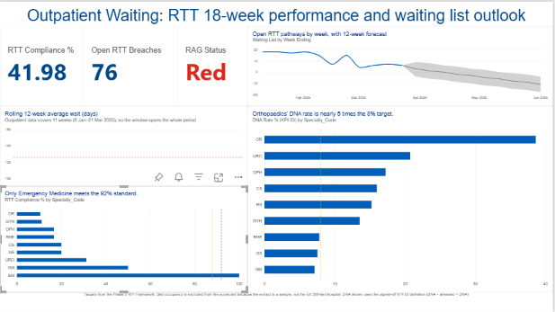
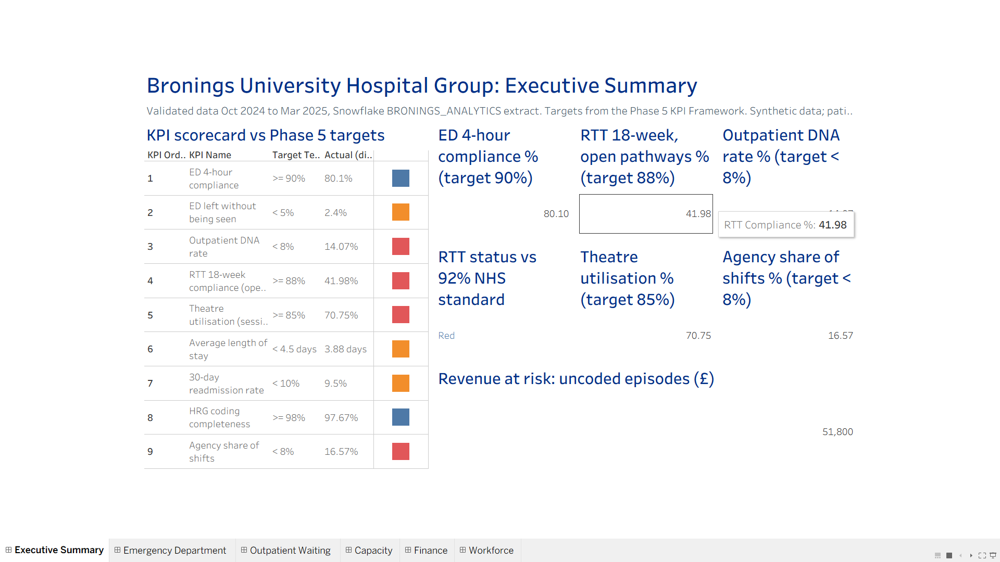

# Bronings University Hospital Group: Healthcare Analytics Portfolio

## Project overview

An end-to-end NHS performance analytics project for a simulated three-hospital acute trust, built in the weeks before an NHS England performance review. Starting from five raw operational extracts (outpatient appointments, inpatient admissions, ED attendances, theatre utilisation and workforce staffing, 4,523 records in total), I audited data quality, investigated performance with SQL, designed an 18-KPI framework, loaded the validated data into Snowflake, built executive dashboards in Power BI and Tableau, automated the weekly waiting-list exception report in Python, and presented the findings to the Board.

The audit found 49 data quality issues, 10 of them critical to statutory returns, including no shared patient identifier across the three clinical systems and three conflicting DNA rates in circulation. After validation, the headline is clear: only **41.54%** of open RTT pathways are within 18 weeks against the 92% standard (**76 patients breaching** across 9 of 10 specialties), the outpatient DNA rate is **14.07%** against an 8% target, and theatres run at **70.75%** with **636 sessions** unused in the year.

The recommendations target the three largest levers: fix patient identity and coding (around £103,600 a year), an Orthopaedic recovery plan using unused theatre capacity, and agency booking controls (around £326,000 a year).

---

## Tools used

| Area | Tools |
|---|---|
| Data quality audit and KPI analysis | Excel (COUNTIFS, SUMPRODUCT, conditional formatting, audit trail) |
| Investigation | SQL Server T-SQL (CTEs, window functions, ROLLUP, GROUPING SETS) |
| Cloud data warehouse | Snowflake (stages, COPY INTO, views, role-based access) |
| Dashboards | Power BI service (web semantic model, 12 DAX measures, scheduled refresh) and Tableau Public |
| Automation | Python (pandas, numpy, openpyxl) in Jupyter |
| Communication | PowerPoint Board presentation with speaker notes and challenge-question answers |

## Key findings

| Area | Finding |
|---|---|
| RTT 18-week (open pathways) | 41.54% vs 92% standard. 76 patients breaching. 90th percentile wait 267 days. 2 patients over 52 weeks |
| Outpatient DNA rate | 14.07% (DNA ÷ ATT + DNA) vs 8% target. Orthopaedics 38.64%, Urology 20.75%. 74 of 76 DNAs GP-referred |
| Theatre utilisation | 70.75% sessions-based (1,538 of 2,174) vs 85%. 636 sessions unused |
| ED 4-hour compliance | 80.10% of all attendances; a range of 79.79% to 83.17% because 39 breach flags are blank |
| HRG coding | 28 uncoded episodes, 97.67% completeness vs 98%, £51,800 income at risk |
| Agency staffing | 252 confirmed agency shifts, £97,020 in 8 weeks. 16.57% of shifts vs 8% target. Ward W-05 highest at 18.83% |
| Readmissions | 9.58% from stored flags, but 17.58% when re-derived from dates. Low confidence until patient identity is fixed |
| Data linkage | No NHS Number is shared across PAS, EHR and EDIS, so every cross-system KPI is unreliable today |

## Dashboard screenshots

**Power BI: Executive Summary (live on Snowflake)**


**Power BI: Outpatient Waiting with 12-week forecast**


**Tableau Public: Executive Summary**


Live Tableau dashboard: see [`tableau/tableau_public_url.txt`](tableau/tableau_public_url.txt)

## Repository structure

```
├── README.md
├── excel/         bronings_investigation.xlsx       DQ Issue Log, calculations, GEN audit trail, duplicates memo
├── sql/           bronings_sql_scripts.sql          12 commented T-SQL investigation queries
├── snowflake/     snowflake_setup_queries.sql       Database, tables, load, views, read-only Power BI role
├── powerbi/       bronings_dashboard.pbix           6-page report (plus dax_measures.txt and nhs_theme.json)
├── tableau/       bronings_dashboard.twbx           6 dashboards, 26 calculated fields
│                  tableau_public_url.txt
├── python/        bronings_automation.ipynb         Weekly waiting-list exception report and DQ scoring
│                  sample_output_exception_report.xlsx
├── presentation/  bronings_board_presentation.pptx  12-slide Board deck with speaker notes
├── docs/          Written reports: DQ log, KPI analysis, SQL report, KPI framework, executive summary,
│                  Board challenge answers
└── images/        Dashboard screenshots
```

## Highlights by deliverable

- **Data quality (Excel):** 49 issues logged with severity, owner and action. Retired GEN code replaced in 24 records with a full audit trail. Duplicate and test records identified.
- **SQL:** 12 investigation queries. Found that a "lost referrals" query returning 100% of pathways was really a cross-system identity failure.
- **KPI framework:** 18 KPIs with exact formulas, sources, NHS standards, Trust targets, named owners and action triggers. One DNA definition replaces three conflicting versions. Theatre utilisation is documented both sessions-based and hours-based.
- **Snowflake + Power BI + Tableau:** one validated source feeding two tools with matching figures. Daily refresh replaces a 6-hour monthly PowerPoint.
- **Python:** the 90-minute manual Monday report now runs in 0.6 seconds (78 hours a year saved). It produces a 9-sheet Excel report including a patient-level list of all 76 RTT breaches and a weekly DQ score for each dataset.

## Running the Python notebook

Place the five source CSVs in `python/data/` (`03_outpatient_appointments.csv` to `07_workforce_staffing.csv`), then run:

```
jupyter nbconvert --to notebook --execute --inplace bronings_automation.ipynb
```

The source data is a synthetic training simulation. No real patient data is included in this repository.

## Contact

[LinkedIn profile](https://www.linkedin.com/in/seembershausu/)
